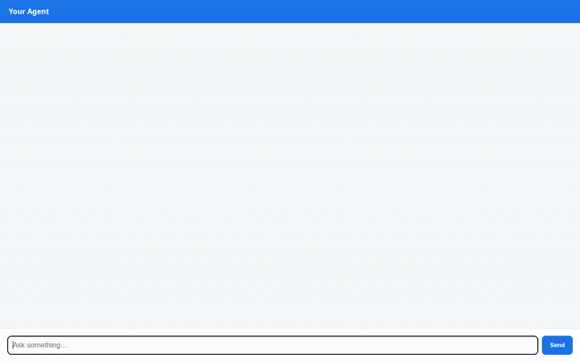

# VentureKit: Fractional CFO & Growth Strategist

VentureKit is an AI agent designed for small businesses and founders to diagnose unit economics, plan high-margin growth strategies, and generate marketing visuals. Built with Google's Agent Development Kit (ADK) and deployed on Agent Platform (Agent Engine).



---

## What VentureKit Does

VentureKit acts as an autonomous strategic financial advisor that:
- **Audits Unit Economics & Margins**: Evaluates CAC, LTV, payback periods, gross margin, burn rate, and runway.
- **Accesses a Catalog of Proven Growth Plays**: Retrieves, lists, and saves actionable strategies for pricing tiers, retainer conversions, and packaging optimizations.
- **Runs Sandboxed Financial Computations**: Executes Python code in a secure execution sandbox to compute exact financial calculations without hallucinating math.
- **Generates Visual Assets**: Creates strategic promotional imagery and animated clips for newly launched growth plays.
- **Handles International Pricing**: Performs live currency conversions across global exchange rates.
- **Retains Long-Term Memory**: Remembers business financial targets, revenue figures, and historical goals across conversations.

---

## Implemented Tools & Google Cloud Services

The codebase implements and integrates the following tools and services:

| Capability / Service | Implementation / Module | Description |
| :--- | :--- | :--- |
| **Model** | `gemini-3.8-flash` via `GlobalGemini` | Primary reasoning engine in `location="global"`. |
| **Cross-Session Memory** | **Vertex AI Memory Bank** (`VertexAiMemoryBankService`, `PreloadMemoryTool`) | Automatically extracts and persists user business profiles, revenue targets, and goals across sessions. |
| **Database** | **Google Cloud Firestore** ([`app/firestore_tools.py`](app/firestore_tools.py)) | Real-time NoSQL store for growth plays (`list_growth_plays`, `get_growth_play`, `save_growth_play`). |
| **Code Sandbox** | **Agent Platform Code Sandbox** (`AgentEngineSandboxCodeExecutor`) | Secure Python sandbox for deterministic financial simulations and metric calculations. |
| **Image Generation** | **Vertex AI Imagen / Flash** (`gemini-3.1-flash-lite-image`) | Generates promotional flyers/visuals, saves artifacts to session context, and publishes to public Cloud Storage. |
| **Video Generation** | **Google Omni Model** (`gemini-omni-flash-preview`) | Generates motion graphics and short clips via the Interactions API, saving artifacts and publishing to Cloud Storage. |
| **Object Storage** | **Google Cloud Storage** | Dedicated public storage bucket for hosting generated campaign images and video assets. |
| **Currency Conversion API** | Frankfurteur Public API ([`app/fx_tools.py`](app/fx_tools.py)) | Live foreign exchange rates for cross-border pricing audits (`convert_currency_pricing`). |
| **Protocol / A2A** | Agent-to-Agent (A2A) Interface | Native A2A protocol support via FastAPI proxy and client SDK. |

> [!NOTE]
> *Status of Features Planned in Brief*:
> - **A2UI Rich Card Rendering**: The web frontend proxy supports rendering A2UI components; rich interactive A2UI forms with direct action dispatch are planned for future releases.

---

## Repository Structure

```text
├── agents-cli-manifest.yaml   # Agent manifest configuration
├── deployment_metadata.json   # Remote Agent Engine runtime deployment details
├── app/
│   ├── agent.py               # Root agent definition, instruction, and memory wiring
│   ├── firestore_tools.py     # Firestore growth play repository tools
│   ├── image_tools.py         # gemini-3.1-flash-lite-image + Cloud Storage integration
│   ├── video_tools.py         # gemini-omni-flash-preview + Cloud Storage integration
│   ├── fx_tools.py            # Free public currency conversion tool
│   └── fast_api_app.py        # Local agent HTTP runner
├── frontend/
│   ├── main.py                # FastAPI proxy communicating via A2A
│   ├── requirements.txt       # Frontend proxy dependencies
│   ├── static/index.html      # Plain chat UI with A2UI card renderer
│   └── Dockerfile             # Container configuration for Cloud Run
└── docs/
    └── assets/demo.gif        # Inline demo recording
```

---

## Getting Started Locally

### Prerequisites
- Python 3.11+
- Google Cloud SDK (`gcloud`) authenticated to your project with Vertex AI, Firestore, and Cloud Storage access.

### 1. Set Up Environment

Clone or navigate to the repository directory:

```bash
cd venturekit
python3 -m venv .venv
source .venv/bin/activate
pip install -r requirements.txt
```

### 2. Run the Local ADK Playground

To run the local ADK developer playground connected to your Vertex AI Memory Bank:

```bash
uv run adk web . --port 8080 --reload_agents --memory_service_uri=agentengine://<YOUR_AGENT_ENGINE_ID>
```

### 3. Run the Web Frontend & Proxy

Alternatively, to run the lightweight chat UI connected to your deployed Agent Engine:

```bash
cd frontend
pip install -r requirements.txt

export AGENT_ENGINE_RESOURCE_NAME="projects/<PROJECT_NUMBER>/locations/<REGION>/reasoningEngines/<REASONING_ENGINE_ID>"
export AGENT_DIRECTORY="app"
export PORT=8080

python3 main.py
```

Open your browser to the local server port to begin chatting with VentureKit.
